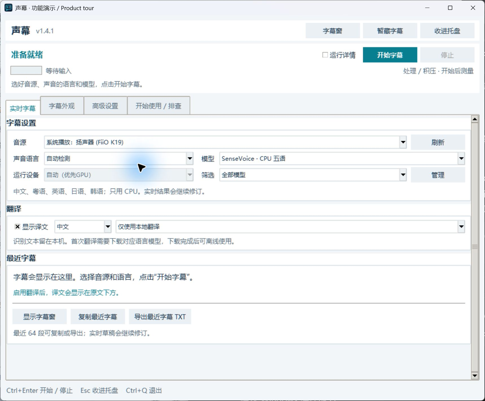
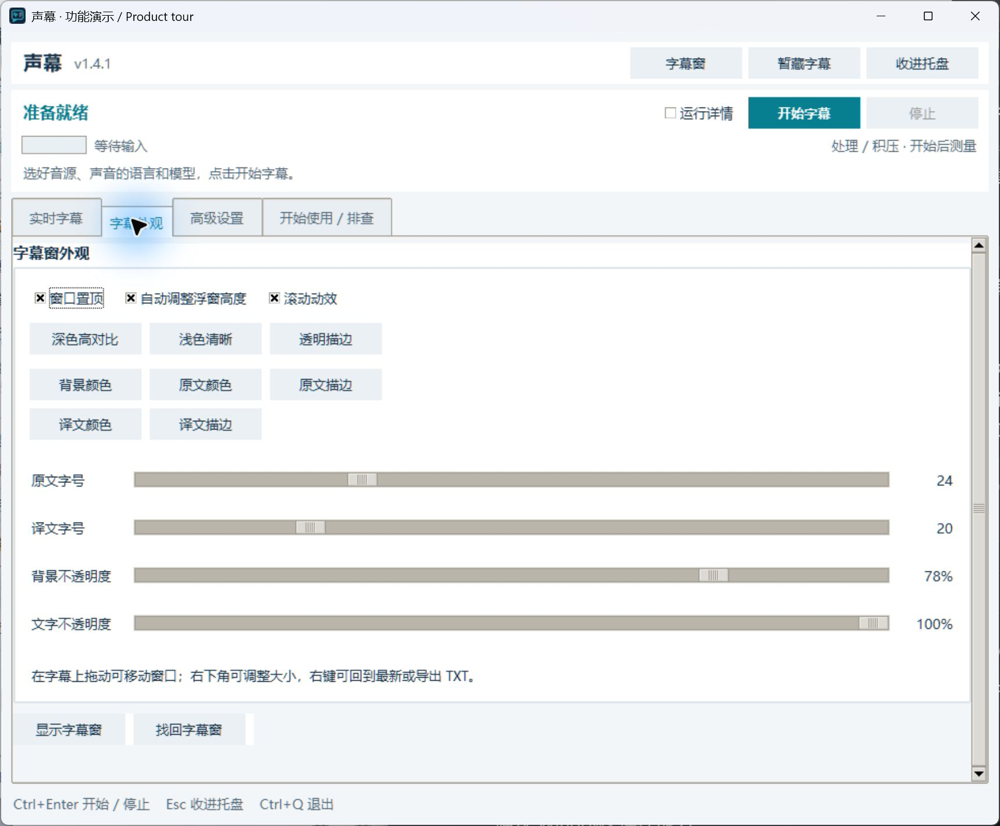

# Shengmu · Live Captions and Translation

<strong>Turn the sound on your PC into captions you can read.</strong>

<a href="README.md">简体中文</a> · English · <a href="https://github.com/Cormor/AudioSubtitleOverlay/releases/latest">Download</a> · <a href="docs/technical-guide.en.md">Technical guide</a>

Follow videos, livestreams, and online classes, or transcribe speech from a microphone. Shengmu displays live captions in a floating Windows desktop window, with optional translations below the original text. You do not need to transcribe a video file first or install Python.

**The app interface is currently in Chinese.** This guide includes the Chinese labels you will see. The executable and repository retain the name AudioSubtitleOverlay.

## What you can do

- **Read while listening:** transcribe PC playback or microphone input. Draft captions are revised as more speech arrives.
- **Show original text and translations:** choose local or online translation, or turn translation off.
- **Make captions comfortable to read:** move and resize the floating window; adjust fonts, colors, and background opacity, or use a preset.
- **Keep useful text:** review the latest 64 segments, copy them, or export a TXT file.
- **Keep your screen clear:** closing or minimizing Settings leaves captions running. Restore Settings from the Windows tray icon.

*Actual app interface photographed with a separate configuration, before capture starts. Device names depend on your speakers, headphones, and microphones.*

## Which file should I download?

**[Open the latest release →](https://github.com/Cormor/AudioSubtitleOverlay/releases/latest)** and expand **Assets**:

| File | What it is for |
|---|---|
| **`AudioSubtitleOverlay_Portable_v1.4.1.zip`** | **The app. Download this first.** For 64-bit Windows 10/11 PCs. |
| `AudioSubtitleOverlay_tiny_model_v1.4.1.zip` | Optional Whisper tiny model, for users who manually select it and want to prepare it offline. |
| `SHA256SUMS.txt` | Checksums for checking download integrity. |

The automatic **Source code (zip/tar.gz)** downloads contain source, not the ready-to-run app. The optional tiny package does **not** contain the default SenseVoice model; that model is prepared separately on first use.

## First-time setup

### 1. Extract and open

Right-click the portable ZIP and choose **Extract All**. Open the extracted `AudioSubtitleOverlay` folder and run **`AudioSubtitleOverlay.exe`**. Keep the `_internal` folder alongside it; it contains files the app needs.

### 2. Choose the sound to transcribe

On **实时字幕** (live captions), set:

| Chinese label | Choose this |
|---|---|
| **音源** — audio source | A **系统播放** (system playback) speaker/headphone device for PC sound, or a **麦克风** (microphone) for your voice. |
| **声音语言** — spoken language | The language being spoken, or **自动检测** (automatic detection). |
| **模型** — model | Start with **SenseVoice · CPU 五语**. It runs on CPU and supports Mandarin Chinese, Cantonese, English, Japanese, and Korean. No dedicated GPU is needed. |
| **显示译文** — show translation | Enable it and choose the output language, or disable it for original captions only. Matching source/target languages skip translation. |

For more languages or NVIDIA GPU options, see the [model guide](docs/technical-guide.en.md#models-and-devices).

### 3. Click 开始字幕 — Start captions

On first use, the app downloads missing models for your selection. Local translation also needs models for the selected language pair. Wait for setup to finish, then play content with speech. Captions appear in the floating window; the main window shows recent text and input level.

Local recognition works offline after its model is ready. **MyMemory online translation**, including fallback to online translation when enabled, sends the text to that service.

## Adjust the appearance

Open **字幕外观** (caption appearance). Try **深色高对比** (dark high contrast), **浅色清晰** (light), or **透明描边** (transparent with outlines), then adjust font sizes and opacity. Drag the overlay to move it, or drag its lower-right corner to resize. **找回字幕窗** brings the overlay back onto the screen.

## Common questions

**No captions after starting?** Check that the content contains speech and watch the input meter. If there is no input, choose the playback device you are actually using. Beta automatic app tracking has OS and compatibility limits; use an explicit system-playback device while troubleshooting.

**Captions are slow or contain mistakes?** Start with the default model. If you use a large Whisper model while the PC is busy, try a smaller model or a suitable GPU option. Live drafts may change; names, accents, and background audio can still cause errors.

**Where did Settings go?** Look in the Windows notification area, including the hidden-icons menu. Click the Shengmu icon to restore Settings. With Settings focused, `Ctrl+Enter` starts/stops and `Ctrl+Q` quits. The tray's right-click menu can also quit.

**Will an update keep my settings?** Settings and models are stored in your user app-data directory. Extract the new version and run its executable; exit the old version to avoid running two copies.

See the **[technical guide](docs/technical-guide.en.md)** for troubleshooting, model details, offline preparation, and development instructions.

## License

The project's own code uses the [Non-Commercial Source-Available License 1.0](LICENSE). Non-commercial use is allowed; commercial use requires prior authorization. Modification, integration, repackaging, and redistribution must meet the license's corresponding-source and authorization terms. Third-party libraries, models, and runtimes have their own terms: see [third-party notices](THIRD_PARTY_NOTICES.md) and [commercial licensing](COMMERCIAL-LICENSE.md).
