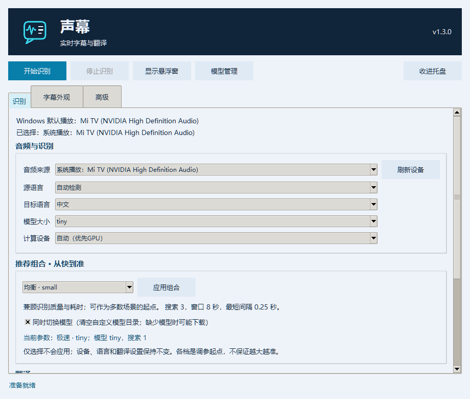

# 声幕 · 实时字幕与翻译

声幕是一款 Windows 桌面字幕应用：把电脑播放或麦克风输入的声音识别为文字，在悬浮窗中显示原文和译文。原项目名称为 AudioSubtitleOverlay，配置、模型与已有文件位置保持兼容。

## 使用起来

1. 从 [GitHub Releases](https://github.com/Cormor/AudioSubtitleOverlay/releases) 下载主程序 ZIP，解压并保留完整的 `AudioSubtitleOverlay` 文件夹。
2. 双击 `AudioSubtitleOverlay\AudioSubtitleOverlay.exe`，选择音频来源、源语言和目标语言，点击“开始识别”。不需要预装 Python。
3. 在“字幕外观”中选择预设，或分别调整原文、译文的字号、颜色与透明度。
4. 关闭或最小化设置窗口后，程序收进右下角托盘，字幕继续运行。点击托盘图标可重新打开设置；右键菜单也可显示／隐藏字幕、开始／停止识别或退出。

首次安装默认等待用户开始识别；已有配置升级后保留原来的自动开始行为。启动选项可在“高级”中调整。本次只想打开设置、不开始采集时，可以使用 `AudioSubtitleOverlay.exe --no-autostart`。

## 功能

- **字幕与翻译**：原文在上、译文在下成对显示；译文未到时显示等待占位。已有译文后，即使原文停更，译文区也保持显示。
- **回看与导出**：保留最近 64 段确认字幕。滚轮或滚动条回看，右键回到最新字幕，也可导出当前内容为 TXT。
- **识别设置**：支持运行中切换音频来源、语言、模型和计算设备。提供极速 tiny、流畅 base、均衡 small、精度优先 medium、大型精度 large-v3 五档推荐组合。选择后点击应用才会生效；可取消“同时切换模型”以保留当前模型或自定义目录。高级页可手动调整搜索范围、参考前文、解码回退、最大音频窗口、更新间隔、重复惩罚、禁止重复词元组、无语音阈值和语音分段停顿。各档是调参起点，不保证模型越大就越准；实际速度也受游戏负载影响。
- **离线与在线翻译**：本地翻译模型首次使用时按语言对准备，完成后可离线使用；在线 MyMemory 后端会把待翻译文字发送到公共接口。纯在线、纯本地和本地优先三种选择分别生效。
- **系统播放与麦克风**：支持播放回环及麦克风输入。Beta 来源可尝试跟踪正在发声的应用，需要 Windows 10 build 20348 或更高版本，部分应用可能不支持。
- **CPU 与 GPU**：支持 CPU 运行；选择 GPU 时优先复用兼容运行库，缺少时再按需准备。
- **设置自动保存**：常用操作固定在顶部；识别、字幕外观和高级设置分开，窗口缩小时可以滚动查看。

原文已停止一段时间且本轮一直没有译文时，会收起空译文区；新原文或译文到达后重新显示。原文与目标语言相同时不调用翻译后端。

## 下载文件

- `AudioSubtitleOverlay_Portable_v1.3.0.zip`：主程序。
- `AudioSubtitleOverlay_tiny_model_v1.3.0.zip`：可选的离线 tiny 语音模型包，解压到主程序相同的父目录。
- `SHA256SUMS.txt`：发布包校验值。

主程序不内置语音或翻译模型。联网时会按需准备缺少的组件；需要携带默认模型离线运行时，请另外下载 tiny 模型包。主程序文件名和配置目录继续沿用 AudioSubtitleOverlay，避免升级后丢失已有设置和模型。

## 本地维护与发布

每次发布都同时更新本机安装版，使用版本目录保留旧文件，并只保留一个当前的开始菜单入口。构建、打包、安装和同步正式发布包的步骤见 [发布流程](docs/releasing.md)。

## English

**声幕** is a Windows live-caption and translation overlay, formerly named AudioSubtitleOverlay. It supports system playback and microphone input, paired source/translated captions, recent-history export, and CPU or NVIDIA GPU recognition. Closing or minimizing Settings keeps the app in the notification area. Its menu can restore Settings, show/hide captions, start/stop recognition, or exit.

Extract the portable ZIP and run `AudioSubtitleOverlay/AudioSubtitleOverlay.exe`. Keep the complete directory, including `_internal`. The executable and configuration paths retain the previous identity for upgrade compatibility. Speech and translation models are prepared separately as needed; an optional tiny-model ZIP is available for offline use. `--no-autostart` opens the app without starting capture for that launch.

## 许可证与商业使用 | License and commercial use

项目自有代码采用 `AudioSubtitleOverlay Non-Commercial Source-Available License 1.0`，完整条款见 [`LICENSE`](LICENSE)。该许可证允许源代码可见，但不是 OSI 认可的 Open Source License。

- 个人、教育、研究、测试、爱好及其他非商业使用默认允许。
- 修改、集成、重新打包或再分发，必须公开完整对应源码和修改说明，或事先取得书面授权。
- 销售、收费分发、商业集成、企业内部业务使用、收入型服务及其他商业使用，必须事先取得商业授权。
- 第三方库、模型和运行库适用各自的许可条款，见 [`THIRD_PARTY_NOTICES.md`](THIRD_PARTY_NOTICES.md)。

The original code is provided under the `AudioSubtitleOverlay Non-Commercial Source-Available License 1.0`; see [`LICENSE`](LICENSE) for the complete terms. Non-commercial use is allowed by default. Modifications, integration, repackaging, and redistribution require public corresponding source with change notes or prior written authorization. All commercial use requires prior written authorization. Third-party components remain under their own terms.

商业授权说明见 [`COMMERCIAL-LICENSE.md`](COMMERCIAL-LICENSE.md)。
