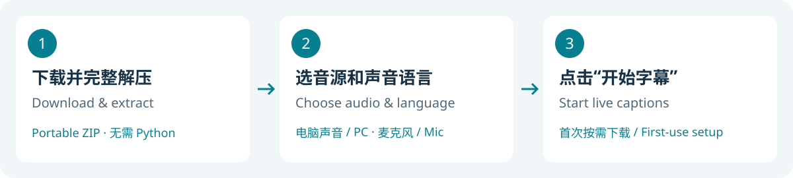
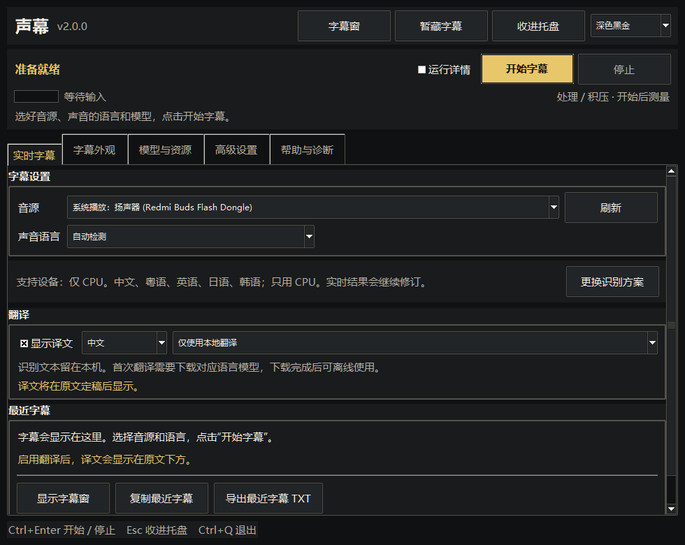
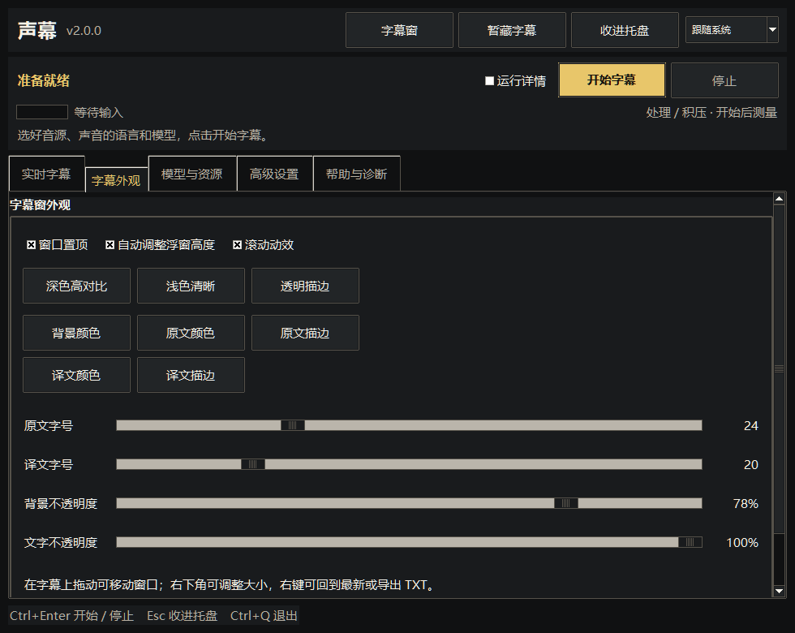

# 声幕 · 实时字幕与翻译

<strong>把电脑里的声音，变成看得见的字幕。</strong>

简体中文 · <a href="README.en.md">English</a> · <a href="https://github.com/Cormor/AudioSubtitleOverlay/releases/latest">下载最新版</a> · <a href="docs/technical-guide.md">技术文档</a>

**当前分支保存2.1源码checkpoint；GitHub已发布下载仍为1.4.1。本轮[译文随语音更新](docs/streaming-translation.md)，工程与验收见[维护说明](docs/refactor-2.0.md)；2.0.3界面修订见[页面与控件设计](docs/ui-design-2.0.3.md)。**

看视频、听直播、上网课，或把麦克风中的讲话转成文字：声幕会在 Windows 桌面浮窗中显示字幕，还能在原文下方显示译文。无需给视频文件先做转写，也不需要安装 Python。

## 它能帮你做什么

- **边听边看字幕**：识别电脑正在播放的声音，或选择麦克风。文字先以草稿出现，再随语音修订。
- **译文随语音更新**：原文草稿出现后就开始翻译，讲话继续时在同一段更新译文，定稿后对齐最终结果。可选本地或在线翻译，只看原文时关闭“显示译文”。
- **按屏幕调整字幕**：移动浮窗，修改字号、颜色、背景透明度，也可一键切换外观预设。
- **回看与保存文字**：回看最近 64 段字幕，复制内容或导出 TXT。
- **收起设置继续用**：关闭或最小化设置窗口后，字幕继续运行；从右下角托盘图标重新打开设置。

*上图为2.0版的开始前界面示例，使用独立配置拍摄；音源名称取决于你的设备。图中“定稿后显示”是旧版提示，2.1在原文草稿期间更新译文，详见[功能说明](docs/streaming-translation.md)。*

## 下载哪个文件

**[打开最新版本下载页 →](https://github.com/Cormor/AudioSubtitleOverlay/releases/latest)**，在页面的 **Assets** 区域找下面的文件：

| 文件 | 用途 |
|---|---|
| **`AudioSubtitleOverlay_Portable_v1.4.1.zip`** | **主程序，第一次使用下载这个。** 适用于 Windows 10/11 64 位电脑。 |
| `AudioSubtitleOverlay_tiny_model_v1.4.1.zip` | 可选的 Whisper tiny 模型。只有手动选择这个模型、并希望离线准备它时才需要。 |
| `SHA256SUMS.txt` | 文件校验值，供需要检查下载完整性时使用。 |

GitHub 自动提供的 **Source code (zip/tar.gz)** 是源码，不能当作主程序双击运行。默认 SenseVoice 模型不包含在可选 tiny 包中，会在首次使用时单独准备。

## 第一次使用

### 1. 解压并打开

右键主程序 ZIP，选择“全部解压”。进入解压后的 `AudioSubtitleOverlay` 文件夹，双击 **`AudioSubtitleOverlay.exe`**。请保留旁边的 `_internal` 文件夹，程序需要它才能运行。

### 2. 选择要听的声音

在“实时字幕”页选择：

- **音源**：看视频或听直播，选择带“系统播放”的扬声器或耳机；转写自己的讲话，选择麦克风。
- **声音语言**：选择对方正在说的语言，或使用自动检测。
- **模型**：点击“更换识别方案”进入“模型与资源”；第一次可保留默认 **SenseVoice · CPU 五语**，支持中文、粤语、英语、日语、韩语，不需要独立显卡。更多语言或 NVIDIA GPU 方案见[模型选择指南](docs/technical-guide.md#模型与设备)。
- **翻译**：需要译文时选择目标语言；同一种语言转成同一种语言时，只显示识别原文，不调用翻译。

### 3. 点击“开始字幕”

第一次会下载所选方案缺少的模型；需要本地翻译时，还会按语言对准备翻译模型。等待准备完成，再播放有讲话的内容。字幕会出现在浮窗里，主窗口也会显示最近结果和输入电平。

模型准备完成后，本地识别可以离线使用。选择 **MyMemory 在线翻译**或允许本地失败后转在线时，待译文字会发送给在线服务。

## 让译文跟上讲话

打开“显示译文”，选择目标语言和翻译方式。译文已对应当前原文草稿时显示“草稿”；原文继续增长、译文还在更新时，保留适用译文并显示“更新中”。新结果返回后原位替换，原文定稿后显示对应的最终译文。

运行中可以调整译文开关、目标语言或翻译方式，识别继续使用当前音源。选择在线翻译时，服务会收到随原文修订提交的片段快照；本地翻译由本机模型处理。具体状态和使用说明见[译文随语音更新](docs/streaming-translation.md)。

## 把字幕调成你喜欢的样子

主窗口右上角可选跟随系统、深色黑金或浅色白金。主窗口主题与字幕个人样式分别保存。

打开“字幕外观”，先试试“深色高对比”“浅色清晰”或“透明描边”，再调整原文、译文字号和透明度。在浮窗上拖动可移动位置，拖右下角可调整大小；找不到浮窗时，点击“找回字幕窗”。

## 常见问题

**开始了却没有文字？** 先确认内容确实有讲话，再看顶部输入电平。没有输入时，在“音源”中改选正在使用的扬声器或耳机。Beta 自动跟踪发声应用有系统版本和兼容限制，排查时先用明确的“系统播放”设备。

**字幕慢，或者有错字？** 先保留默认模型；使用 Whisper 大模型且电脑负载较高时，可换较小模型或合适的 GPU 方案。草稿修订属于实时识别过程，专名、口音和背景声仍可能造成错字。

**翻译暂时失败？** 原文会继续更新。工作进程异常后，下一段会重新创建翻译服务；检查当前语言、本地模型或在线连接。粤语识别文字使用中文文本翻译模型，口语表达的译文仍需留意。

**关闭设置后，程序去哪了？** 查看 Windows 右下角托盘，必要时点向上的箭头展开隐藏图标，点击声幕图标恢复。设置窗口获得焦点时，`Ctrl+Enter` 开始/停止，`Ctrl+Q` 退出；托盘右键菜单也可退出。

**升级会丢设置吗？** 配置和模型保存在用户应用数据目录，升级会保留。解压新版本后使用新文件夹中的程序，退出旧版本，避免同时运行两份。

更多排查、模型说明、离线准备和构建方法见 **[技术文档](docs/technical-guide.md)**。目前程序界面为中文，英文使用指南见 **[English](README.en.md)**。

## 许可证

项目自有代码采用 [Non-Commercial Source-Available License 1.0](LICENSE)，允许非商业使用；商业使用需事先获得授权。修改、集成、重新打包或再分发须遵守许可证中的对应源码公开及授权要求。第三方库、模型和运行库适用各自条款，见[第三方说明](THIRD_PARTY_NOTICES.md)与[商业授权说明](COMMERCIAL-LICENSE.md)。
