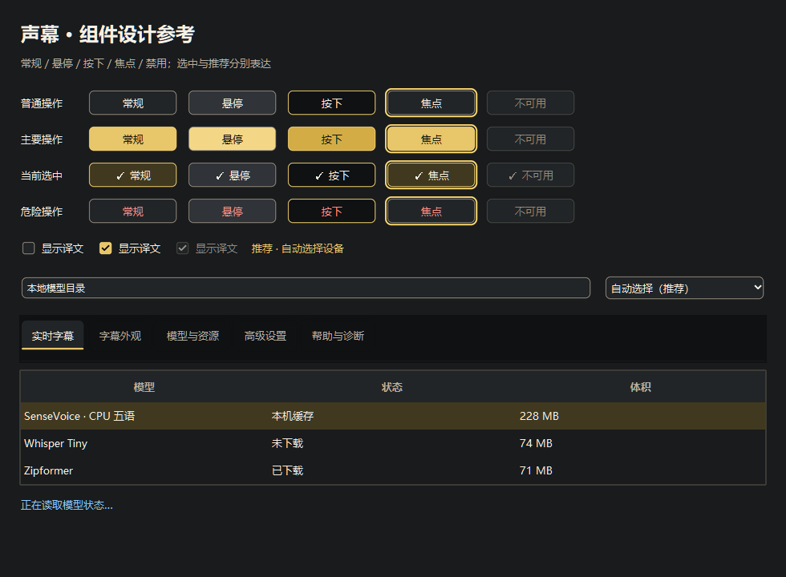
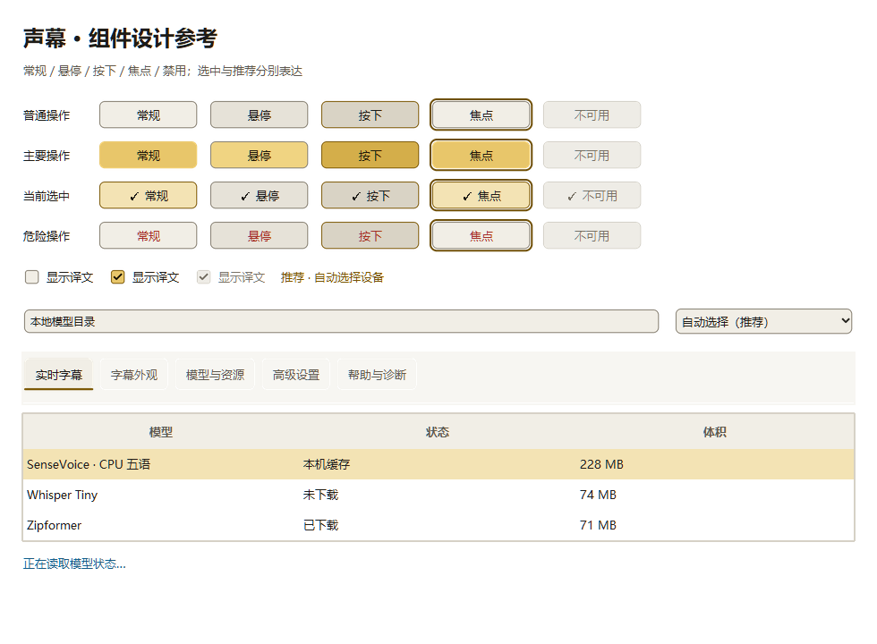
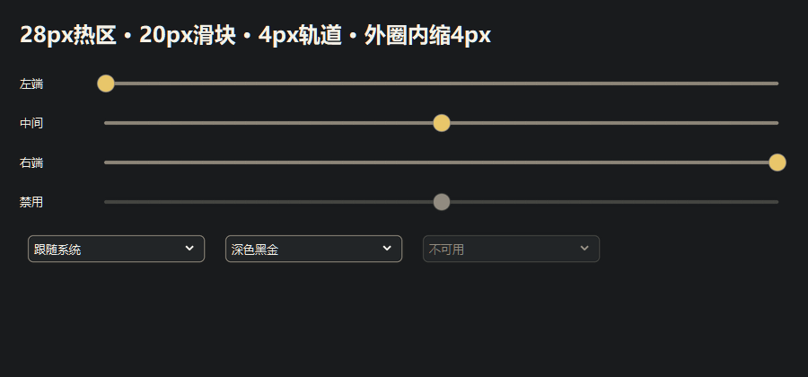
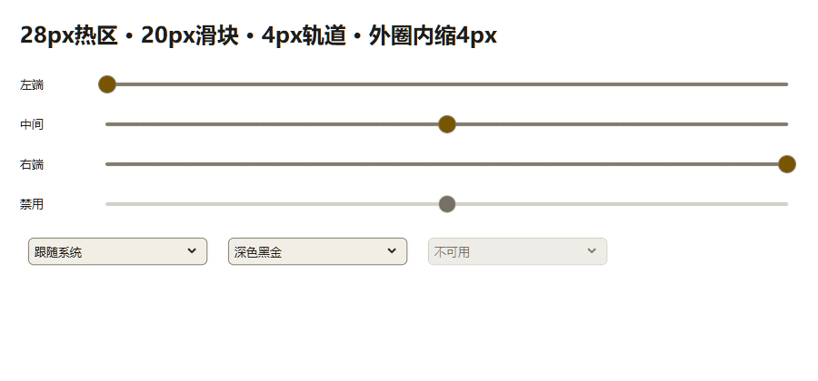

# 声幕桌面组件设计与走查

设计修订：2.0.3，2026-10-28。服务于 Windows 桌面上“持续识别并读到字幕与译文”的任务。用户截图中的模型表格不可读、禁用按钮近似可点击、复选框与标签页风格不统一，是本轮必须解决的问题。

## 依据与项目选择

公司 `SoftwareCompany/design/tokens.json` 提供语义色与物理动效基线，声幕的 `design_tokens.json` 是随安装包分发的项目适配；`theme.py` 将令牌映射到实际 ttk 控件。Windows/Fluent 为平台参考，W3C 对比度方法用于本项目桌面可读性检查，不宣称桌面产品通过 WCAG 认证。

| 设计内容 | 依据 | 声幕中的选择与理由 |
| --- | --- | --- |
| 几何 | [Microsoft Geometry](https://learn.microsoft.com/en-us/windows/apps/design/signature-experiences/geometry) 的常驻控件 4px、浮层 8px圆角参考；公司普通按钮8px | 普通按钮与输入8 Tk px、复选框3 Tk px，统一抗锯齿；项目采用公司值，不把8说成微软按钮规定 |
| 空间 | [Microsoft Content layout and spacing](https://learn.microsoft.com/en-us/windows/apps/design/basics/content-basics) 的8/12/16 epx分组示例 | 主要留白采用4/8/12/16/24 Tk px；紧凑桌面表单采用10px横内距、6–8px行间距，3/5px用于字体基线和行内说明的光学校正。项目按角色取值，内容区与操作区分组，长说明独立成行 |
| 字体 | [Windows Typography](https://learn.microsoft.com/en-us/windows/apps/design/signature-experiences/typography) 的文字层级思路 | 中文 Microsoft YaHei UI，正文10pt、状态12pt加粗、产品名18pt加粗；不把Tk点数等同DIP |
| 状态与主题 | [Microsoft WinUI LOB design](https://learn.microsoft.com/en-us/windows/apps/get-started/line-of-business/design-for-lob)、[Keyboard interactions](https://learn.microsoft.com/en-us/windows/apps/develop/input/keyboard-interactions) | 默认、悬停、按下、焦点、禁用、选中分别设计；焦点与选中不互相替代；全窗口深浅色适配 |
| 可读性 | [W3C文字对比度](https://www.w3.org/WAI/WCAG22/Understanding/contrast-minimum.html)、[非文字对比度](https://www.w3.org/WAI/WCAG22/Understanding/non-text-contrast.html) | 所有可用正文与底色目标≥4.5:1，必要边界/焦点≥3:1；禁用文字仍保持可辨识。装饰分隔线不承担唯一分组或状态表达 |
| 单位 | [Tk font](https://www.tcl-lang.org/man/tcl8.6/TkCmd/font.htm)、[Windows DPI](https://learn.microsoft.com/en-us/windows/win32/learnwin32/dpi-and-device-independent-pixels) | 正数字号为pt；padding/radius为Tk逻辑像素。记录Tk scaling与实际截图尺寸，不再手工乘Windows缩放造成双重放大 |

## 组件契约

颜色均引用语义名，深浅主题分别取值。普通按钮不采用金色填充；主操作“开始字幕”采用 accentFill/onAccentFill（深色用accent/onAccent）；正在识别时开始按钮禁用，停止按钮保留可点击轮廓。禁用控件采用 disabledSurface/textDisabled/disabledBorder，点击不触发。危险操作沿用普通轮廓并用 danger 文字和明确动词表示。

| 组件 | 尺寸与结构 | 状态规则 |
| --- | --- | --- |
| 按钮 | 8px圆角、横14/纵9px padding，随文字自然增高 | 悬停背景提升，按下加深；键盘焦点外侧2px实线；禁用取消强调填充并降权 |
| 输入、只读下拉 | 8px圆角、横10/纵8px padding，箭头14px | 必要边界controlBorder；焦点独立外圈；只读仍可选择；禁用文字和箭头降权；弹出列表与当前主题同步 |
| 复选框 | 绘制24×24px指示区、整行含文字可点；选框3px圆角 | 选中显示勾；焦点独立外框；禁用选中仍显示勾；不沿用白底黑X |
| 页签 | 横16/纵12px padding，所有页签同一基线 | 当前页表面与3px底部金线；仅键盘模式且页签有焦点时在同位置加厚为5px，不加包围轮廓；鼠标及窗口重新激活不额外强调，几何与基线不跳变 |
| 参数预设 | 同普通按钮 | 实际匹配参数的项加“✓”和选中边框；其余普通；改变参数后更新匹配状态 |
| 数据表 | 行高至少34px，表头加粗，深浅色正文与空白区一致 | 选中采用selection底色；离焦后仍保留；当前操作对象另有“已选中”文字详情；不以Windows蓝色和浅底继承状态 |
| 卡片/分区 | 普通表面surface，紧凑分区内边距10px、常规12–16px，分区间8–12px | 标题与留白分组；边线separator仅装饰；避免每个控件再套厚边框 |
| 滚动条、滑块、进度 | 轨道canvas/控件边界，拖动状态accent | 不把进度数值或采样调度当作界面动画；字幕运动继续使用现有阻尼弹簧 |
| 状态信息 | 正文text，说明textMuted，信息info，错误danger | 文案明确“正在准备/识别/停止/失败”；颜色不单独承担含义 |

推荐是建议，选中是当前设置，运行状态是实际执行，三者分别表达。例如“自动选择（推荐）”说明优先GPU、失败用CPU的设备策略；并不证明当前正在GPU上运行。模型支持哪些设备、是否下载、当前选用哪个模型分别显示，不按体积自动标“最好”，不因推荐自动修改用户配置。

## 布局与窗口范围

主窗保留五个任务页：实时字幕、字幕外观、模型与资源、高级设置、帮助与诊断。运行状态与开始/停止固定在上方；运行详情可展开。模型管理表格承载可比较字段，长说明放在选中详情；列宽按字体测量，必要时只在表内横滚，下载动作与运行依赖分组，窄窗不靠无限横向扩张容纳按钮。字幕浮窗保留用户个人字号、颜色、透明度和位置；主窗主题不覆盖它。

系统文件/颜色选择对话框沿用 Windows 原生呈现，不能据 ttk 主题宣称其已变为自绘主题。用户内容仅留在本机，走查用独立APPDATA与公共测试文案，不将私人字幕放进产品参考图。

## 设计走查与交付条件

1. 先核对组件契约，再看实际窗口，不能只检查令牌或`ttk.Style`定义。
2. 主窗五页、展开详情、模型管理及其空白区、下拉列表、字幕浮窗都检查深浅主题；已打开的下拉层和子窗口在切换主题后仍可读。
3. 检查常规、悬停、按下、Tab焦点、禁用、选中、推荐；验证禁用不触发、焦点可见、选中不随离焦消失。
4. 检查常规与最小窗口、长中文文本、深滚动和键盘访问屏外控件；放大文字时可滚动到全部操作，不能压字或裁掉选项。
5. 按实际系统DPI与进程DPI上下文记录截图；模拟字体缩放与修改系统显示缩放分开记录，不写成等价验证。
6. 先做源码实际窗口走查，再对最终安装包截图/交互核对；完成字幕与译文真实输入、上屏、正常退出的回归，保留正式用户配置。
7. 交付前独立复核截图、状态表、实装证据与设计契约；核心可读性、遮挡或任务失败须修复后复验。后续优化与本轮阻断问题分开记录。

实际执行证据保存在本次对话工作区 `evidence/design-walk/`，最终走查结论随交付记录给出。参考图由真实组件画廊生成，画廊的强制状态展示与真实指针/键盘交互证据分别记录。

## 实际组件参考

以下是2.0.1在Windows实际ttk控件上生成的历史画廊，字号与几何为Tk逻辑尺寸；页签焦点与下拉展开以2.0.3有效设计和同包证据为准，旧画廊不再定义这两项当前外观。真实鼠标/键盘与安装包验收另记。

复现设计走查：`python tools/verify_design.py --output <E盘证据目录> --text-scale 1`，另取1.5和2检查文字放大。脚本只操作自己创建的窗口、使用独立APPDATA、不采集音频，退出后比对正式配置。

模型大小是可选元数据：查询显示已处理数，结束后说明取得与未取得的数量；失败不阻断本地模型状态与识别。重复刷新合并为同一个查询，下载/错误提示优先于迟到的大小结果。

## 2.0.2几何纠正与逐条走查

组件规格、明确判退条件及本轮结果见[CG-01/02/03组件复核](control-review-2.0.2.md)。四条滑轨将28px交互区与4px可见轨道分开，滑块圆直径20px；输入文字与箭头共同处于4px边框内缩。鼠标拖动交接键盘焦点，按下/释放/失焦状态对应显示，不能把页签上的焦点框计作滑块焦点。尺寸为本项目Tk逻辑像素选择，抗锯齿允许±1px边缘误差。

`python tools/verify_control_geometry.py --output <E盘证据目录>` 按上述规格测实际窗口像素，并执行拖动极值、键盘、禁用和末尾操作可达检查。数值通过仍需按规格查看真实状态与最终包图像，不能自动判定所有视觉语义通过。

## 2.0.3页面设计与展开态

完整页面设计、下拉状态契约、输入事件依据与流程缺口修正见[2.0.3设计修订](ui-design-2.0.3.md)。既有组件画廊保留其历史参考范围，页面级设计图与对应状态图先行评审；最终包以实际展开层与读回结果核对，不以旧画廊代替新设计。
